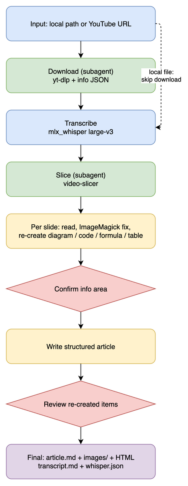
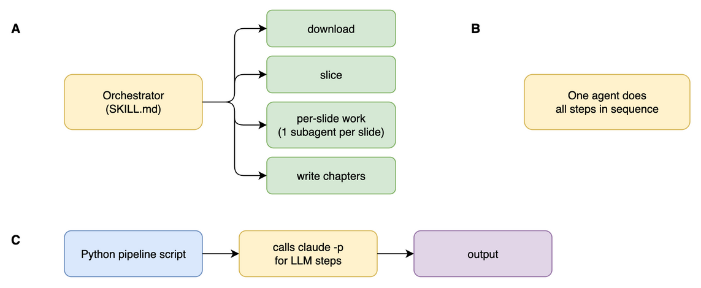
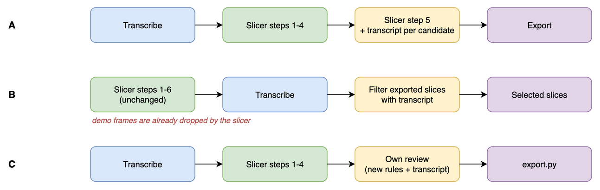
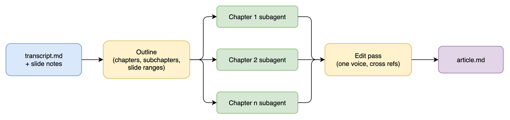

# Talk to article

A Claude Code skill that turns a video recording of a talk or lecture into two deliverables:

- **Transcript**: the spoken word, timestamped
- **Article**: a textbook-style document built from transcript and slides, properly structured, with edited images and re-created diagrams, code, formulas and tables

Related:

- [CLAUDE.md](../../../CLAUDE.md): purpose and earlier decisions
- [brainstorm/index.html](brainstorm/index.html): questions, options and answers of the brainstorm
- [video-slicer](https://github.com/christianbaumann/video-slicer): slide extraction
- `/Users/christian.baumann/git_repos/_own/music-transcriber/.claude/skills/downloading-youtube-video/SKILL.md`: YouTube download
- `/Users/christian.baumann/git_repos/_own/music-transcriber/.claude/skills/transcribing-sheet-music/references/youtube-input.md`: precedent for briefing vendored skills as subagents

## Pipeline

The pipeline from input to final output, with the two user gates (red):



Source: [brainstorm/pipeline.drawio](brainstorm/pipeline.drawio)

Step details:

1. **Download** (YouTube URL only): subagent runs the vendored `downloading-youtube-video` skill, extended by `--write-info-json` for the info area.
2. **Transcribe**: `mlx_whisper` large-v3, `--word_timestamps True`. Writes `transcript.md` and `whisper.json`.
3. **Slice**: subagent runs vendored `video-slicer`; its step 5 (review) gets the transcript excerpt of each candidate (see [Image selection](#image-selection-uses-the-transcript)).
4. **Per slide**: one subagent per slide, in parallel. Reads the slide, fixes the image, re-creates non-text content, notes content the speaker does not say. Writes `slides/NNNN.md`.
5. **Info area**: orchestrator gathers values from all sources, user confirms and fills gaps.
6. **Write**: outline, then chapters in parallel, then an edit pass.
7. **Review**: user compares re-created items with the original screenshots.
8. **Final**: article without review screenshots; Markdown + self-contained HTML.

## Output

One folder next to the video; for a YouTube URL next to the download in `out/youtube/`.

```text
<video>-article/
├── article.md          # final article, info area first
├── article.html        # self-contained (pandoc), images embedded, KaTeX
├── transcript.md       # spoken word, [HH:MM:SS] per paragraph, slide markers
├── whisper.json        # raw whisper output, word timestamps
├── images/             # edited screenshots used in the article
├── diagrams/           # .drawio (or other source) + exported image
├── reference/          # original slide screenshots of re-created items
└── imagemagick.log     # every ImageMagick command, for reproducibility
```

Original slices stay in `<video>-slices/` (video-slicer default). Work files (slide notes, outline, review answers) live in a temp directory.

## Structure

Skill name: `transcribing-talks`.

```text
.claude/skills/
├── transcribing-talks/              # orchestrator skill
│   ├── SKILL.md                     # pipeline, user gates, subagent briefs
│   ├── references/
│   │   ├── slicer-review.md         # step-5 override for video-slicer
│   │   ├── slide-processing.md      # per-slide brief + slide note format
│   │   └── article-writing.md       # outline, chapter and edit briefs
│   ├── scripts/                     # Python, uv, PEP 723
│   │   ├── transcribe.py            # mlx_whisper -> whisper.json
│   │   ├── transcript.py            # whisper.json (+ slices) -> transcript.md; excerpt by time range
│   │   ├── review.py                # review page, local server, answers.json
│   │   ├── build_html.py            # article.md -> self-contained article.html (pandoc)
│   │   └── tests/
│   └── evals/                       # evals.json, grade.py
├── video-slicer/                    # vendored, commit 9887d2e
└── downloading-youtube-video/       # vendored + --write-info-json
testdata/talks/<name>/               # video + pptx/pdf gitignored, ground truth committed
```

## Interfaces

```text
transcribe.py <video> --out <dir>                         -> <dir>/whisper.json
transcript.py <whisper.json> [--slices <dir>] --out transcript.md
transcript.py <whisper.json> --excerpt HH:MM:SS-HH:MM:SS  -> text on stdout
review.py --notes <slides dir> --info <info.json> --out <dir>  -> <dir>/answers.json
build_html.py article.md --out article.html
```

Slide note `slides/NNNN.md` (written by the per-slide subagent, read by review and article writing):

```markdown
---
slide: 7
time: "00:12:34"
image: <video>-slices/0007_00-12-34.png
kind: diagram            # text | diagram | code | formula | table | photo | screenshot | mixed
show_screenshot: false   # true when the image adds what re-creation cannot
assets:                  # re-created items, paths relative to the article folder
  - diagrams/0007-architecture.drawio
  - diagrams/0007-architecture.svg
edited_image: images/0007.png   # only when show_screenshot is true
unspoken:
  - Latency numbers per region (table, not mentioned in the talk)
---

<slide text as read from the image>
```

## Key Decisions

### Orchestrator skill with subagents per phase



- **Decision:** One orchestrator `SKILL.md` (option A). Download, slicing, per-slide work and chapter writing run as subagents; the orchestrator passes absolute paths and collects results.
- **Reason:** A 45 min talk with 50 slides does not fit into one context. Subagents keep each step small and let per-slide and per-chapter work run in parallel. Same pattern as music-transcriber.
- **Trade-offs:** More briefs to maintain; results come back as summaries. Rejected: one agent for all steps (context overflow), Python pipeline calling `claude -p` (hard to add user gates, loses the skill format).

### Vendor video-slicer and the download skill

- **Decision:** Copy both into `.claude/skills/`. video-slicer gets a provenance comment with the source commit (currently `9887d2e`). The download skill gets `--write-info-json`.
- **Reason:** The skill behaves the same on every machine and in tests; versions change only on purpose.
- **Trade-offs:** Updates need a manual diff against the source repo. Rejected: separate install in `~/.claude/skills/` (silent version drift), git submodule (extra setup).

### Image selection uses the transcript



- **Decision:** Option A. Transcribe before slicing. The slicer brief overrides step 5: each candidate gets the transcript text of its time range; demo frames (IDE, terminal, browser) are kept when the speaker refers to them, otherwise the slicer's own rules apply.
- **Reason:** The slicer drops all demo frames by default, but tool screenshots can carry content the article needs. Reuses the slicer's review instead of a second one.
- **Trade-offs:** The brief override must track changes to the slicer's step 5. Rejected: own review step (duplicates rules), filter after export (dropped frames cannot be recovered).

### Transcription with mlx_whisper large-v3

- **Decision:** `mlx_whisper`, model large-v3, word-level timestamps. Slide text may go into `--initial_prompt` for names and technical terms.
- **Reason:** Best local accuracy, fast on Apple Silicon. Word timestamps align slides with text.
- **Trade-offs:** Mac-only. Rejected: openai `whisper` (much slower), cloud APIs (audio leaves the machine, cost).

### Transcript and article are separate deliverables

- **Decision:** `transcript.md` holds the spoken word (`[HH:MM:SS]` per paragraph, `→ slide 0007` markers) plus `whisper.json`. The article is a rewrite, not an edited transcript.
- **Reason:** The transcript is a source and a reference; the article is a readable text with its own structure.
- **Trade-offs:** Two outputs to keep consistent.

### Per-slide processing in one subagent per slide

- **Decision:** One subagent per slide, several in parallel. Input: slide PNG and transcript excerpt of its time range. Output `slides/NNNN.md`: slide text, kind of content, content not spoken, re-created assets, ImageMagick commands.
- **Reason:** Each slide needs vision, image editing and re-creation; one slide per context keeps quality high.
- **Trade-offs:** Many agents (one per slide). Rejected: batches of 10 (less parallel), orchestrator does all (context overflow).

### Slide reading by Claude, OCR as cross-check

- **Decision:** Claude reads each slide image; `tesseract` cross-checks small text.
- **Reason:** Vision handles layout and meaning; OCR catches misread small print.
- **Trade-offs:** Two passes per slide.

### Slide content is a source of its own

- **Decision:** Content on a slide that the speaker does not say goes into the article.
- **Reason:** Slides often hold details (lists, numbers, references) that the talk skips.
- **Trade-offs:** The writer must merge two sources without duplicating content.

### Image editing with ImageMagick, driven by the agent

- **Decision:** The agent looks at each image and chooses `magick` operations (lighting, colors, contrast, etc.). The article uses the edited image; the original stays in `<video>-slices/`; every command goes to `imagemagick.log`.
- **Reason:** Recordings vary in exposure and color; a fixed filter does not fit all. The log makes edits reproducible.
- **Trade-offs:** Results depend on the agent's judgment per image.

### Re-create non-text content

- **Decision:** Diagrams redrawn, draw.io by default (`.drawio` next to its exported image); per diagram the agent chooses another format (e.g. Mermaid) when it works better. Formulas as LaTeX (`$…$`, `$$…$$`, KaTeX in HTML) and as rendered image. Code as fenced blocks with language. Tables as Markdown tables.
- **Reason:** Re-created content is searchable, sharp and editable; screenshots of diagrams and code are not.
- **Trade-offs:** Re-creation can introduce errors, hence the review gate.

### Screenshots only where they add something

- **Decision:** A slide that is fully re-created is not shown as an image. Screenshots stay for photos, tool screenshots and complex visuals.
- **Reason:** Avoids duplicated content in the article.
- **Trade-offs:** The reader does not see the original slide design.

### Review pass before the final article

- **Decision:** A review version shows each re-created item (formula, code, diagram, table) next to its original screenshot. After approval the final article drops these screenshots; they stay in `reference/`.
- **Reason:** Re-creation errors are found against the source; the final text stays clean.
- **Trade-offs:** One user round per talk.

### Review UI: local HTML page with form

- **Decision:** The orchestrator serves a local HTML page (original screenshot next to re-created item, ok / fix + comment per item; also the info-area values). A localhost server writes the answers to a JSON file the agent reads.
- **Reason:** Side-by-side comparison of many images is impractical in chat. Same pattern as music-transcriber's image reviews.
- **Trade-offs:** Needs a small server script. Rejected: Markdown review with answers in chat, published Claude artifact.

### Info area at the start of the article

- **Decision:** Title, event, date, source/URL, duration, speaker/author. Filled from YouTube metadata (`info.json`), title slide, speaker's introduction, file name; no guessing. The user confirms and fills gaps on the review page.
- **Reason:** Readers need to know what the article is based on; automatic sources are incomplete.
- **Trade-offs:** One more user step.

### Title from transcript, then file name

- **Decision:** Title from the title slide or speaker's introduction; fallback file or video name.
- **Reason:** File names of recordings are often technical (`720p_24fps_H264`).
- **Trade-offs:** None notable.

### Chapter structure from slides and transcript



- **Decision:** Section and title slides give the frame when the deck has them; transcript topic shifts refine it. Many decks have no such slides; then the structure comes from the transcript alone. Writing: outline (chapters, subchapters, slide and time ranges), one subagent per chapter in parallel, one edit pass for a single voice and cross references.
- **Reason:** Works for decks with and without structure slides; parallel chapters keep long talks within context.
- **Trade-offs:** The edit pass must even out style differences between chapter agents. Rejected: single-pass writing (context limits), no edit pass (uneven style).

### Article language

- **Decision:** English or German. Same as the talk if it is one of the two; for any other language, ask the user. The user can always override.
- **Reason:** User's choice.
- **Trade-offs:** None notable.

### Output formats

- **Decision:** Markdown (`article.md` + folders) and a self-contained HTML page via `pandoc`.
- **Reason:** Markdown stays editable; HTML is a single file to share.
- **Trade-offs:** Two outputs; HTML depends on pandoc's KaTeX and embedding.

### Scripts in Python with uv, tests with pytest

- **Decision:** Deterministic steps (transcription call, transcript formatting, review server, HTML build) as Python scripts with PEP 723 inline dependencies, run with `uv`. Tests: `uv run --with pytest pytest`. Skill evals against reference talks.
- **Reason:** Same toolchain as video-slicer and music-transcriber.
- **Trade-offs:** None notable. Rejected: shell scripts (hard to test).

### Reference talks for evals

- **Decision:** Two talks with their decks, stored in a gitignored `testdata/talks/<name>/`; ground truth derived from them is committed.

  | Talk | Video | Deck |
  |---|---|---|
  | Don't be a fool with a tool (askui Hackathon 2023-03) | 46 min, 1280x720 | 55 slides, .pptx + .pdf |
  | Extreme learning situations as testers (EclipseCon 2020) | 22 min, 1920x1050 | 31 slides, .pptx + .pdf |

  A third talk (AgileTD 2025, "Dragons") was added later: see [backlog-qa-dragons](../2026-11-26-backlog-qa-dragons/design.md).
  Ground truth: slide images from the PDFs, slide text and speaker notes from the .pptx (`pptx-to-markdown` skill). The decks match the recordings, so slides compare 1:1.
- **Reason:** Slide recall and "unspoken content reaches the article" can be checked against a known source, as in video-slicer's own evaluation.
- **Trade-offs:** Large files stay outside git; a fresh clone needs them copied from `~/Downloads`. Animations: the askui deck has entrance animations on 7 slides (20 effects, no exit effects). The PDF shows the final state, and the slicer keeps only the final state of a build, so they match; earlier build steps do not count as missed. Slides shown under 2 s are missed by the slicer by design.

## Open points

- Exact brief for the slicer's step 5 override
- Concurrency limit for per-slide and per-chapter subagents
- Eval metrics and thresholds (slide recall, unspoken-content coverage)
